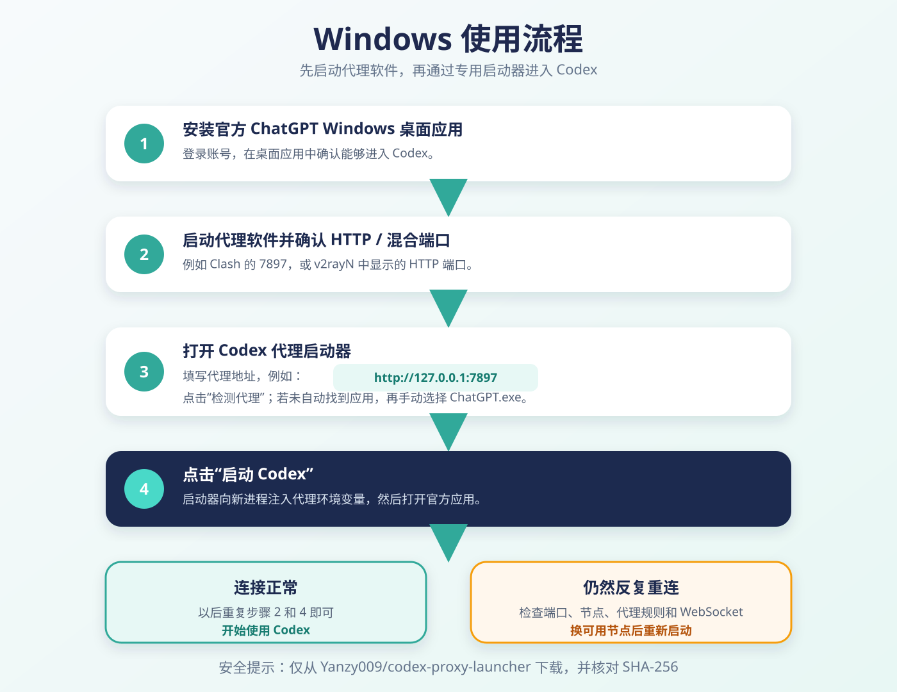

# Codex 代理启动器（Windows）使用说明

## 使用前准备

1. 从 OpenAI 官方渠道安装并登录包含 Codex 的 ChatGPT Windows 桌面应用。
2. 安装并启动自己的代理软件，例如 Clash 或 v2rayN。
3. 在代理软件中确认 **HTTP 端口**或**混合端口**，常见示例为 `7897`、`7890` 或 `10809`。

## 首次使用

1. 双击 `Codex-Proxy-Launcher-Windows-x64-setup.exe` 完成安装。
2. 打开“Codex 代理启动器”。
3. 输入代理地址，例如 `http://127.0.0.1:7897`。
4. 点击“检测代理”。
5. 如果启动器没有自动找到官方应用，点击“选择程序”，选择 `ChatGPT.exe` 或旧版 `Codex.exe`。
6. 点击“启动 Codex”。

以后请先启动代理软件，再从“Codex 代理启动器”进入 Codex。启动器只给新启动的 ChatGPT / Codex 进程设置代理环境变量，不会永久修改 Windows 系统代理。

## 常见问题

- **代理端口无法连接**：确认代理软件正在运行，并核对 HTTP/混合端口；不要填写 SOCKS 专用端口。
- **Codex 已经运行**：新代理只对新进程生效。保存正在进行的任务后，允许启动器正常关闭并重新打开应用。
- **找不到官方应用**：在开始菜单中找到 ChatGPT，右键查看文件位置，或在任务管理器中查看 `ChatGPT.exe` 的文件位置，然后在启动器中手动选择。
- **SmartScreen 提示**：本项目没有商业代码签名。只从本仓库 Release 下载，并核对 SHA-256 后，再选择“更多信息 → 仍要运行”。
- **仍然反复重连**：端口可达不代表代理节点可用。检查代理规则、节点状态以及 WebSocket 是否被允许。

